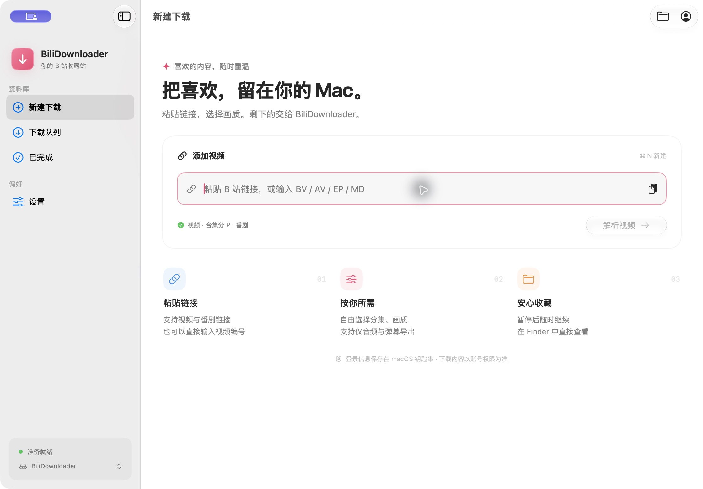
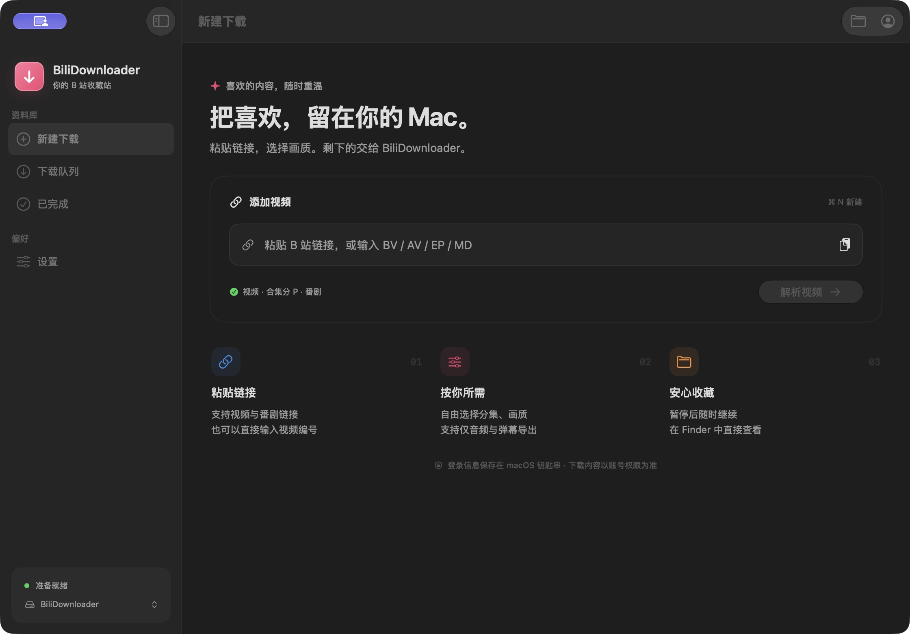
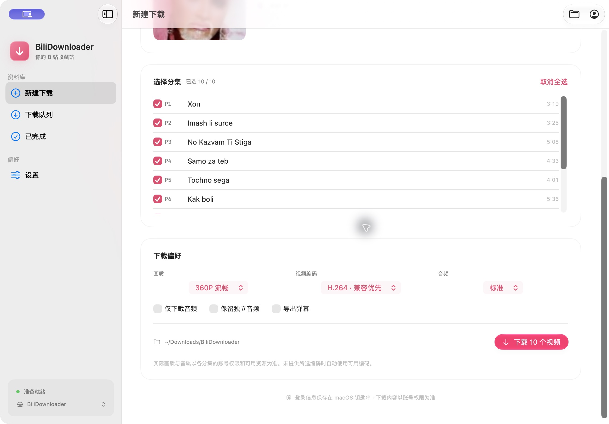

# BiliDownloader-macOS


## 介绍

一款开源、简洁的 **哔哩哔哩视频下载器 macOS 原生版**，采用 SwiftUI 和 Liquid Glass 界面，按 macOS 27 风格设计。

本项目基于 **[Majjcom/BiliDownloader](https://github.com/Majjcom/BiliDownloader)** 的 Windows / Python 版本适配，沿用其视频解析、WBI 签名及下载流程。感谢原作者 **[Majjcom](https://github.com/Majjcom)** 的开源工作。本仓库为独立 macOS 适配，并非原项目官方发行版。

README 的介绍、使用和注意事项结构参考原 Windows 版；[原版 README](README.windows.md) 与 `src/` 中的原始 Python 源码均予以保留。



## 下载与安装

前往 **[Releases](https://github.com/HachiMiku39/BiliDownloader-macOS/releases/latest)** 下载 `BiliDownloader-macOS.dmg`，打开后将 App 拖入“应用程序”即可。

- 支持 **Apple Silicon（M 系列）**，最低 **macOS 26**；已在 macOS 27.2 验证。
- **已内置 FFmpeg，无需安装 Homebrew、Python 或 Qt。**
- 同时提供 ZIP 便携包。Intel 版尚未构建和验证。
- 当前使用本地临时签名，尚未经过 Apple 公证；首次打开可能需要在“系统设置 → 隐私与安全性”中确认。

## 使用

输入 **BV、AV、MD、EP、SS 编号**，或粘贴 B 站视频、番剧、`b23.tv` 短链接，点击“解析视频”。MD 编号指番剧详情页链接中的 `mdxxxx`。

1. 确认视频信息，勾选要下载的分集。
2. 选择画质、视频编码和音轨，也可选择“仅下载音频”“保留独立音频”或“导出弹幕”。
3. 选择保存文件夹，点击下载。
4. 在“下载队列”中暂停、继续或重试；完成后在 Finder 中查看。

在“设置”中可修改默认下载位置、同时下载的任务数、每个文件的连接数和浅深色外观。需要账号权限的内容，请通过二维码登录哔哩哔哩账号。

## 功能

- **原生 Mac 界面**：系统工具栏、玻璃按钮、半透明侧边栏、浅深色模式和 Finder 文件夹选择器。
- **分段并发下载**：每个文件可使用 1 / 2 / 4 / 8 个连接，默认 4 个；多个任务独立排队，默认同时下载 2 个。
- **安全续传**：已完成分段保留；使用文件大小、强 ETag / 可用 Last-Modified 与 Content-Range 校验，避免拼接不同版本的数据；服务器不支持安全分段时自动回退。
- **音视频合并**：内置 FFmpeg，支持 H.264、HEVC、AV1 视频流的无损封装，以及可用的标准、FLAC 和 Dolby 音轨。
- **音频与弹幕**：支持仅音频、独立音频、XML 原始弹幕及普通滚动/固定弹幕 ASS 导出。
- **账号保护**：扫码登录，凭据存放在 macOS 钥匙串中。
- **任务记录**：下载历史本地保存，重新打开后可继续未完成任务。

分段并发下载设计参考 **[Gopeed](https://github.com/GopeedLab/gopeed)** 的 HTTP 下载调度与一致性校验思路，本项目使用 Swift / URLSession 实现。速度仍取决于网络、CDN 和账号权限。

## 注意事项

**本应用不提供会员资源的免权限下载。** 如需下载会员或付费资源，请登录拥有相应权限的账号。

部分视频和高清画质需要大会员；未登录时可能只能获取较低画质。明确返回试看的内容不会作为完整视频下载。实际画质、编码和音轨以各分集可用资源为准，不支持受 DRM 保护的内容。

画质菜单与原 Windows 版一样，展示接口列出的视频画质（包括 1080P、4K 等）。标有“待获取”的选项暂未返回对应视频流，仍可选择，下载时会按所选画质重新请求；如果仍未提供，则使用实际可用画质，并在完成状态中提示所选与实际画质。

仅下载你有权保存和使用的内容。B 站接口变化可能影响解析和下载。

## 演示图片

### 浅色模式


### 深色模式



### 分集与画质选择



## 构建与测试

使用 Xcode 26 或更新版本，在仓库根目录执行：

```sh
./macos/scripts/build-app.sh
```

脚本会校验并编译固定版本的 FFmpeg 源码，生成包含 FFmpeg 的 `.app`、`.zip` 和 `.dmg`。首次构建需要联网下载源码，具体要求见 **[macOS 构建与使用说明](MACOS.md)**。

```sh
# 完整测试需要 Python 3 和 FFmpeg 生成本机测试媒体
./macos/scripts/test.sh
```

Mac 客户端位于 `macos/`，原始 Windows / Linux 构建方式见 [SETUP.md](SETUP.md)。

## 来源、致谢与许可

- 原项目：**[Majjcom/BiliDownloader](https://github.com/Majjcom/BiliDownloader)**，原作者 **Majjcom**，保留其 [MIT 许可证](LICENSE) 和版权声明。
- 下载设计参考：[GopeedLab/gopeed](https://github.com/GopeedLab/gopeed)。
- 媒体合并：[FFmpeg](https://ffmpeg.org/)，本包使用 LGPL 2.1 或更新版本许可的构建；对应源码、校验和、许可证及构建说明随 App 附带。
- 本项目应用源码采用 MIT 许可；第三方组件各自遵循其许可，详见 [第三方声明](THIRD_PARTY_NOTICES.md)。
